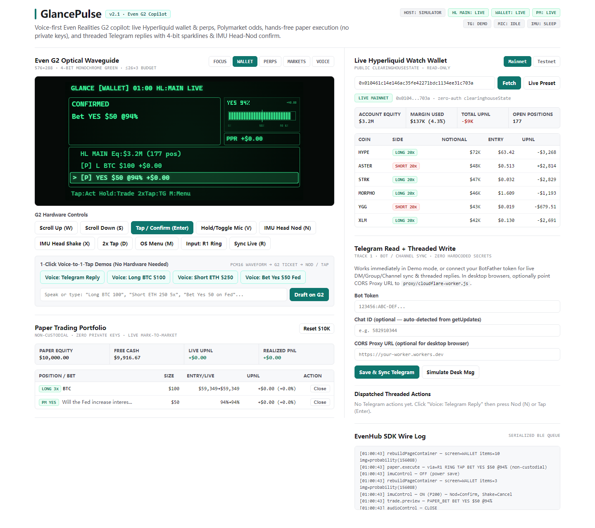

# GlancePulse v2.1 — Voice-First Crypto, DeFi & Telegram Focus-Card Copilot for Even Realities G2

Built for the **Heads Up: Even Realities Hackathon** targeting **Track 02 (Crypto & DeFi)**, **Track 01 (Messaging & News)**, **Special Prize (Best Telegram Integration)**, and **Grand Prize**.

- **Live Browser G2 Optical Simulator**: https://lhortl.github.io/glancepulse-g2/
- **HD Demo Walkthrough Video (1280×720)**: https://lhortl.github.io/glancepulse-g2/glancepulse-v2-demo.mp4
- **Pre-Built EvenHub `.ehpk` Package**: https://github.com/LHorTL/glancepulse-g2/releases (`min_app_version 2.2.10`, SDK `0.0.16`)



> *"Check a wallet balance, live odds or an open position; place a paper perp order or prediction bet — or reply to Telegram — by voice and confirm with one tap or a head nod."*

## What Makes GlancePulse v2.1 Different

**GlancePulse v2.1** delivers complete **Read + Write loops** across both **Crypto & DeFi** and **Telegram Messaging** inside a single **4-Second Quiet-Tech Loop** on Even Realities G2 (`576×288` 4-bit monochrome green waveguide) paired with a clean minimal-white companion console:

1. **Live Hyperliquid Watch Wallet & Open Positions (Track 2 Read, Zero Custody / Zero Auth)**:
   - Queries public zero-auth Hyperliquid `clearinghouseState` across **Mainnet** (`api.hyperliquid.xyz/info`) and **Testnet** (`api.hyperliquid-testnet.xyz/info`).
   - Displays live account equity, margin ratio, unrealized PnL, and top open perp positions directly on the G2 `WALLET` screen and companion table — with a **1-Click Live Preset** active trader address plus any custom `0x...` address lookup.
2. **Voice-to-1-Tap / IMU Head-Nod Paper Perp Orders & Polymarket Paper Bets (Track 2 Write, Zero Private Keys)**:
   - Hold the R1 ring or temple touchpad (or click the **1-Click Voice Demo** buttons / command bar in the companion console) and speak commands such as `"Long BTC 100"`, `"Short ETH 250"`, or `"Bet Yes 50 on Fed"`.
   - Previews the structured Order or Bet Ticket on the G2 lens (`≤ 26 chars × 3 lines` strict typography budget alongside the live 4-bit sparkline or probability gauge), then **Nod your head** (`IMU_DATA_REPORT`) or **1-Tap** to execute into the persistent local paper ledger — with **real-time mark-to-market uPnL** tracked against live Hyperliquid prices and live Polymarket odds — or **Shake** / double-tap to cancel cleanly.
3. **Heads-Up Telegram Focus Card + Threaded Voice Replies (Track 1 Read + Write)**:
   - Displays priority Telegram chats and channel posts (`getUpdates` with `offset = update_id + 1` and `allowed_updates=["message","channel_post"]`).
   - Auto-links mentioned assets and macro topics (`BTC`, `ETH`, `SOL`, `HYPE`, `SUI`, `ARB`, `Fed`, `FOMC`, `Polymarket`) to live Hyperliquid perps or Polymarket YES/NO odds, with context-aware smart replies and hands-free threaded voice replies (`reply_to_message_id`).
4. **Real 4-Bit Grayscale Graphics (`ImageContainerProperty` + `updateImageRawData`)**:
   - Zero-dependency pure-JS grayscale PNG encoder renders live **24h Hyperliquid sparklines** (`candleSnapshot`), **Polymarket probability gauges**, and **16-bar 16kHz PCM16 voice waveforms** directly into G2's `184×84` image container.
5. **Hardware-Authentic G2 Protocol Hardening**:
   - **Proto3 zero-value safety**: Handles omitted `0`/`undefined` on `CLICK_EVENT` and Row-0 `currentSelectItemIndex` with `currentSelectItemName` fallback.
   - **Zero flicker & zero double-scroll**: Serialized BLE queue uses incremental `textContainerUpgrade` + `updateImageRawData` on 30s refreshes instead of flashing `rebuildPageContainer`.
   - **Real G2 ~21px typography budgets**: Every screen (`FOCUS`, `WALLET`, `PERPS`, `MARKETS`, `VOICE`) and confirmation ticket is strictly bounded (`≤ 38` chars header/footer, `≤ 26` chars × `≤ 3` lines card, `borderColor: 8..10` on `0..15` scale) and validated by `validateEvenHubPageContainer`.
   - **Clean Crypto/Macro Polymarket Feed**: Queries `/markets/keyset` with `end_date_min`, filtering out sports and settled odds (`< 5%` or `> 95%`), ranking Crypto/Fed/FOMC markets first.

## Quick Start

```bash
npm install
npm test            # Run 21 unit tests (Hyperliquid wallet, paper trading, SDK validation, PNG, proto3, IMU, Telegram)
npm run dev         # Launch browser G2 optical simulator & minimal-white companion console
npm run build       # Production Vite bundle -> dist/
npm run pack:g2     # Build EvenHub .ehpk package (v2.1.0)
```

### Testing in Official EvenHub Simulator

```bash
npm run dev
npx @evenrealities/evenhub-simulator http://localhost:5173
```

## G2 Temple / R1 Ring / IMU Controls (Keyboard Shortcuts in Simulator)

| Hardware Gesture | Simulator Key | Action |
|---|---|---|
| Scroll Up / Down | `W` / `S` or `↑` / `↓` | Move list highlight + refresh sparkline/detail (`textContainerUpgrade` + `updateImageRawData`) |
| Single Tap | `Enter` | Execute action / Confirm paper order, bet, or Telegram reply / Close paper pos / Toggle alert |
| Hold Temple / R1 Ring | `V` (or `1-Click Voice` buttons) | Push-to-talk G2 Mic capture (`audioControl(Glasses)`) → release to preview order ticket or TG draft |
| IMU Head Nod | `N` | Hands-free confirm & execute pending paper order/bet or send threaded Telegram reply |
| IMU Head Shake | `X` | Hands-free cancel pending ticket or reply draft |
| Double Tap | `D` | Cancel pending draft/ticket / Next Telegram message (`FOCUS`) / Push live Pulse (`WALLET`/`PERPS`/`MARKETS`) |
| Switch Screen / OS Menu | `Tab` / `M` | Cycle screens (`FOCUS` · `WALLET` · `PERPS` · `MARKETS` · `VOICE`) or open G2 `MenuContainerProperty` |

## Packaging, Privacy & Non-Custodial Architecture

- `app.json` declares minimal permissions: `network` (`gamma-api.polymarket.com`, `api.hyperliquid.xyz`, `api.hyperliquid-testnet.xyz`, `api.telegram.org`) and `g2-microphone`.
- **Zero private keys, zero wallet custody, zero hardcoded secrets** — Hyperliquid wallet lookups use public read-only `clearinghouseState`; paper orders/bets and optional Telegram Bot credentials persist strictly in EvenHub / browser local storage.
- For standalone desktop browser Telegram testing outside Even App WebView (where Telegram Bot API omits CORS headers on JSON `POST`), deploy the included 45-line zero-secret [proxy/cloudflare-worker.js](./proxy/cloudflare-worker.js) and paste its URL into the optional **CORS Proxy URL** field.

## License

MIT — see [LICENSE](./LICENSE).
